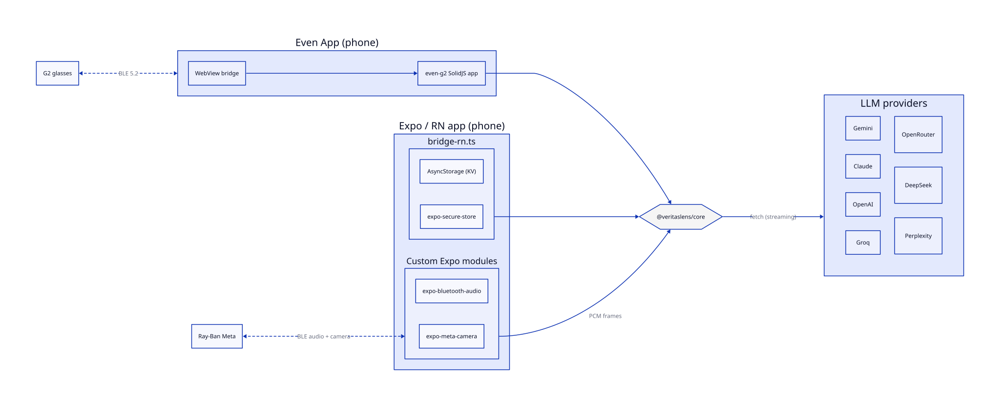

# VeritasLens

A real-time **contextual intelligence layer** for smart glasses. VeritasLens listens to a configurable rolling buffer of conversation audio and — on a single temple tap — streams it to your chosen LLM, displaying a glanceable result on the HUD or phone.

> **Silent intelligence for your glasses.** Built as a single web bundle for the Even App WebView and a React Native companion for Ray-Ban Meta. No server, no native code on G2, audio uploads happen on request or through explicitly enabled hands-free assistance, live captions, or summaries.

---

## Monorepo layout

VeritasLens is an npm-workspaces monorepo. The platform-agnostic brain lives in `@veritaslens/core` and is consumed by two host packages:

```
packages/
├── core/        # @veritaslens/core — lenses, LLM providers, audio buffer, VAD,
│                #   streaming JSON parser, transcript, history, store shim
├── even-g2/     # @veritaslens/even-g2 — SolidJS WebView app for Even Realities G2
│                #   (the HUD-driven primary target — `.ehpk` for Even Hub)
└── rayban/      # @veritaslens/rayban — Expo / React Native app for Ray-Ban Meta
                 #   (phone-driven; BLE audio + camera via custom Expo modules)
```

Run any workspace script from the root:

```bash
npm install                         # installs all workspaces
npm test    --workspaces            # run tests in every package
npm run lint --workspaces           # tsc --noEmit across the tree
npm run build --workspaces --if-present
```

Or target a single workspace:

```bash
npm run dev   --workspace=@veritaslens/even-g2     # Vite dev server on :5173
npm run sim   --workspace=@veritaslens/even-g2     # Even Realities desktop simulator
npm run pack  --workspace=@veritaslens/even-g2     # build → dist/veritaslens.ehpk
npm start     --workspace=@veritaslens/rayban      # Expo dev server
```

---

## Lenses (12 available tools)

Pick one in the picker, or let **Auto** decide. Every lens streams structured JSON via `StreamingJsonParser`, so the HUD fills in as the response arrives.

| Lens | What it does | Web grounding |
|---|---|---|
| **Best next help** | Uses your session profile and goal to choose useful help, or stays quiet. | inherited |
| **Help me respond** | One natural response, acknowledgment, clarification, or follow-up grounded in the exchange. | — |
| **Fact Check** | Labels up to 5 check-worthy claims (including numerical ones) `TRUE / FALSE / UNVERIFIED`, with a `correction` line on FALSE. | ✓ |
| **Quick Answer** | Direct answer + brief description, with optional alt phrasing. | ✓ |
| **Fallacy Check** | Names the logical fallacy and gives a polite `callOut` phrase. | — |
| **Framing Check** | Detects political, factional, emotional, or tonal framing; offers a `counterFrame`. | — |
| **Simplify** | Plain-language restatement: punchy `oneLine` + richer `expanded`. | — |
| **Devil's Advocate** | Strongest counterargument plus a conversational `pivot` lead-in. | ✓ |
| **Key Questions** | Open / unanswered questions ranked `CRITICAL / IMPORTANT / NICE`. | — |
| **Interesting context** | Up to 5 short tidbits — facts, stats, anecdotes, or unexpected connections. | ✓ |
| **Translate** | Listens to a foreign-language speaker, shows their words + translation, and (Converse mode) suggests 3 reply starters. Auto mode = hands-free continuous translation. | — |
| **Prepared assistance** | Real-time answers grounded in notes + labeled attachments you wrote on your phone beforehand. Every answer carries a verbatim **evidence** excerpt; an opt-in **follow-up** fires only when prep is silent on a decision-changing detail. Opt-in **"Verify public claims with web search"** checkbox lets the lens cross-check what the other party says against current web results — web-sourced answers show `Web · domain` attribution. | opt-in |

Each lens also returns a self-rated `HIGH / MED / LOW` confidence per claim and a verbatim ≤140-char `quote` from the audio.

Plus a built-in **Lens Game** mode (`personas/game.ts`, `runtime/gameHistory.ts`) that turns recent conversation into a 1-question quiz.

---

## Conversation profiles and flows (Even G2)

The phone opens on **Session**. Choose Everyday, Work, or Understand, then start
without preparation or expand **Goals, notes & saved setups** to add a goal,
constraints, selected person/project notes, and a named setup. Selected notes
are sent to the configured analysis provider; unrelated notes are excluded.
Prepared assistance uses selected session notes alongside its labeled attachments.

**Lenses** is a separate catalogue with Conversation, Knowledge, and Arguments
categories. **Games** has its own page, reached from Lenses. History, Settings,
and AI setup retain their own navigation sections. Session drafts survive page
changes until saved; saved setups are also selectable on the glasses.

On glasses, single-tap opens the menu. **Help with this exchange** offers Reply,
Explain, Check, Ask, Clarify/disagree, Remember, Catch up, Translate, and prepared
assistance. **Examine the argument** contains the optional argument tools.
**Refine or correct** reuses the latest captured exchange for shorter/more natural
answers, explanations, or corrections. Double-tap captures a new exchange or
cancels an in-flight request. Refinement leaves later speech available for the
next check. The temporary audio snapshot is cleared when the session ends.

**Session tools** separates microphone pause/resume, hands-free triggering, and
live captions. Pausing preserves the session while stopping audio capture and
caption/automatic requests. Dismissing a cue only hides its display. Unpinned
cues expire after the configured duration; pinned cues suppress hands-free
interventions and remain in history. Best next help can return no intervention;
standard profiles reserve argument criticism for deliberate requests.

Live captions are opt-in and use the configured Whisper host/key (or a custom
Whisper endpoint). Speech is transcribed in serial chunks, approximately every
four seconds plus provider latency, without requiring an analysis tap. Captions
are not a complete permanent transcript and do not establish speaker identity.
Their display is available on the phone and under Session tools on glasses.

Remember and end-of-session review capture structured decisions, commitments,
and questions. Proposals remain distinct from agreements; missing owners and
deadlines stay explicit. History review separates my, other, and unassigned
commitments, exposes supporting quotes, permits corrections, and exports the
session or pinned moments as text. A saved moment can become a background note
that must be explicitly selected for a future session. Catch-up answers only
from captured audio/context, which may cover only part of a conversation.

## LLM providers

Bring your own key — one per provider, stored on-device. The chat host and audio path differ per provider; routing lives in `core/src/llm/index.ts`.

| Provider | Chat host | Audio path | Web search | Notes |
|---|---|---|---|---|
| **Gemini** (default) | `generativelanguage.googleapis.com` | Inline `generateContent` audio | `google_search` tool | Default provider. |
| **Claude** | `api.anthropic.com` | STT sidecar → tool-use streaming | `web_search_20250305` tool | Borrows STT from a `SttHost` (Groq Whisper or OpenAI Whisper). |
| **OpenAI** | `api.openai.com/v1` | `/audio/transcriptions` (whisper-1) → `/chat/completions` | Switches to `/v1/responses` with `web_search` for grounded lenses (gpt-5* / gpt-4.1* / gpt-4o*) | Self-transcribes. |
| **Groq** | `api.groq.com/openai/v1` | `/audio/transcriptions` (whisper-large-v3) → `/chat/completions` | Overrides to `groq/compound` (Tavily-backed) | Self-transcribes; recommended STT for Claude / chat-only hosts. |
| **OpenRouter** | `openrouter.ai/api/v1` | Inline `input_audio` content part | `:online` model suffix | Model picker filters to audio-capable models. |
| **DeepSeek** | `api.deepseek.com/v1` | Borrowed STT → chat completions | Borrows your Perplexity key for a pre-search call to `api.perplexity.ai/search` | Needs a separate key for the chosen STT host. |
| **Perplexity** | `api.perplexity.ai` | Borrowed STT → chat completions | Native via `sonar-*` models | Same chat-only pattern as DeepSeek. |

Grounded lenses (Fact Check, Trivia, Devil's Advocate, Companion, Meeting Prep with web grounding on) automatically pull fresh web results before answering, and the history detail page shows a `Sources: …` sub-page with up to 5 source domains. When the active provider/model can't ground (e.g. DeepSeek without a Perplexity key, OpenAI pinned to a reasoning model), the badge picks up a trailing `°` glyph so the wearer knows the answer came from training data alone.

The **Test** button in Settings runs `runSelfTest()` against the active draft, so an unsaved key/model surfaces failures before first real use.

---

## Features

- **Streaming HUD.** Every lens emits structured JSON as it's generated. Headings (Trivia answer, Translate text, Companion headline, Simplify one-liner, Fact correction) fill in character-by-character via `streamHeading` watchers; multi-claim lenses pop each claim onto the HUD as it closes.
- **Multi-claim per tap.** Fact, Framing, Fallacy, Trivia, Simplify, Companion, Devil's Advocate, and Key Questions can return up to 5 distinct items per request. Single-tap walks forward through them.
- **Per-claim verbatim quote.** ≤140-char source quote attached to every claim, most recent first.
- **Skip silence and noise.** Local Silero v6 VAD (with an Earshot candidate filter) gates every tap; silent or too-noisy taps short-circuit before any API call. HUD flashes `○` (no voice) or `~` (too noisy).
- **Rolling transcript.** A multi-source transcript (`core/src/runtime/transcript.ts`) merges STT byproducts and inline audio output across taps so later lenses see what was said earlier in the session — at zero extra API spend on providers that already transcribe.
- **Multi-language responses.** 11 Latin-script European languages (English, Dansk, Svenska, Norsk, Deutsch, Français, Español, Italiano, Português, Nederlands, Polski). Verdict labels stay canonical English so HUD glyphs render correctly.
- **Glanceable HUD layout.** Lens-specific result on the 576×288 4-bit greyscale G2 display. Result persists until the next action.
- **Searchable session history.** Every analysis is persisted (KV store on G2, encrypted SecureStore for keys on Rayban). Search matches quote / question / verdict / lens name **and auto-derived tags** from each entry's content.
- **End-of-session Summary.** Leaving a session — manually or by changing provider, model, key, or buffer length — writes a final 5-minute interval summary plus an overall synthesis. Silent intervals are skipped.
- **Configurable buffer.** 30 s, 1 min, 2 min, or 5 min of rolling PCM (capped at 5 min to match the Summary cadence).
- **Continuous recording.** The PCM ring buffer keeps filling during compute / display / menu so the next analysis covers anything said in between. A `●` indicator shows when the mic is hot.
- **Hide / re-reveal via swipe.** Swipe down past the last answer hides the result; swipe up brings it back.
- **Session-wide swipe scroll.** Swipe up/down walks every answer in the session, not just the latest. `X/Y` indicator counts session entries.
- **Previous answer stays on screen during analysis.** Last result remains visible with a small top-right spinner during the next call.
- **Discreet HUD (optional).** Listening shows only a small recording dot — no `● REC` label, no affordance hint. Mic capture is unchanged; display-only.
- **Exit menu opt-out.** A separate `Exit` action ends the session *without* writing the stop-time summary, for when you'd rather not bake a transcript into history.
- **Zero-persistence audio.** PCM lives in a single in-memory ring buffer. Nothing is ever written to disk.
- **BYOK.** Per-provider keys never leave the device except as part of the request you trigger.

---

## Gestures (G2)

| On glasses | Picker | Active session | Menu | History list |
|---|---|---|---|---|
| Single tap | Start selected lens | Next claim → menu after last | Confirm highlight | Open entry |
| Double tap | Trigger analysis | Trigger analysis (cancels in-flight) | Trigger analysis | Trigger analysis |
| Swipe up | — | Previous answer (cross-entry) | Cycle up | Cycle up |
| Swipe down | — | Next answer / hide past last | Cycle down | Cycle down |

Menu: `← Back`, `Check`, `History`, `Exit` (writes summary), `Exit (no summary)`.

The right-temple touchpad is the primary input. The host normalizes `CLICK_EVENT (0)` to `undefined` and routes `DOUBLE_CLICK_EVENT` through `sysEvent` without an index; the runtime mirrors list cursors in JS to handle both paths.

---

## Architecture



> Source: [`docs/architecture.d2`](docs/architecture.d2) — regenerate with `d2 docs/architecture.d2 docs/architecture.svg`.

### `@veritaslens/core`

The platform-agnostic brain. No DOM, no React, no Solid in the hot path (Solid is used only for the persona registry signal and the settings shim).

```
packages/core/
├── index.ts                       # public surface
└── src/
    ├── types.ts                   # LensResult union, Settings, providers, model lists
    ├── llm/
    │   ├── index.ts               # provider router (callLens, callLensStream, runSelfTest)
    │   ├── gemini.ts              # generateContent client + model fetch
    │   ├── openai.ts              # whisper + chat completions (OpenAI / Groq / DeepSeek / Perplexity / OpenRouter)
    │   ├── claude.ts              # messages API + tool-use streaming
    │   ├── gameClient.ts          # Lens Game streaming client
    │   ├── tools.ts               # web-grounding tool spec + provider resolution
    │   ├── streamingJsonParser.ts # claim / field / valueChunk / noSpeech events
    │   └── fetchTimeout.ts        # AbortController-aware fetch with timeout
    ├── personas/
    │   ├── index.ts               # registry + LensGrounding + StreamHeadingConfig
    │   ├── _utils.ts              # shared prompt helpers
    │   ├── auto.ts                # Auto classifier
    │   ├── factChecker.ts         # Fact Check
    │   ├── trivia.ts              # Trivia
    │   ├── logicalFallacy.ts      # Fallacy Check
    │   ├── biasDetector.ts        # Framing Check
    │   ├── eli5.ts                # Simplify
    │   ├── devilsAdvocate.ts      # Devil's Advocate
    │   ├── keyQuestions.ts        # Key Questions
    │   ├── companion.ts           # Companion
    │   ├── translation.ts         # Translate (Converse + Listen-in)
    │   ├── meetingPrep.ts         # Meeting Prep (prep-grounded answers)
    │   ├── sessionSummary.ts      # End-of-session summary
    │   └── game.ts                # Lens Game
    ├── runtime/
    │   ├── audioBuffer.ts         # PCM ring buffer + WAV encoder + base64
    │   ├── autoMode.ts            # Auto-lens routing
    │   ├── transcript.ts          # rolling transcript (multi-source merge)
    │   ├── transcriptSource.ts    # transcript source modes (chat-byproduct, inline)
    │   ├── recallContext.ts       # cross-tap context builder
    │   ├── relevanceGate.ts       # short-circuit irrelevant taps
    │   ├── history.ts             # persisted history + tag derivation
    │   ├── gameHistory.ts         # Lens Game history
    │   ├── ttsText.ts             # text → spoken summary
    │   └── vad/                   # Silero VAD adapter (warmup + analysis)
    └── state/store.ts             # Settings shim injected by hosts at bootstrap
```

### `@veritaslens/even-g2`

The SolidJS WebView app that runs inside the Even App on G2.

```
packages/even-g2/
├── app.json                       # Even Hub manifest (package_id, permissions, whitelist)
├── index.html
├── vite.config.ts
└── src/
    ├── main.tsx                   # bootstrap; bridge init; auto-launch HUD
    ├── main.css
    ├── App.tsx                    # SettingsView shell
    ├── views/SettingsView.tsx     # config UI (lenses, providers, keys, models, language, history)
    ├── state/store.ts             # Solid signals + settings + history persistence
    └── runtime/
        ├── bridge.ts              # SDK singleton + raw-message wiretap
        ├── bootstrap.ts           # configureSettings + configureDebugEvents into core
        ├── hud.ts                 # HUD pages: unconfigured / picker / active / menu / history
        ├── lifecycle.ts           # event routing, gestures, session state machine
        └── game.ts                # Lens Game HUD pages
```

`main.tsx` boots the same bundle in two modes determined by the SDK's `LaunchSource`. In `settings` mode (phone) it renders `SettingsView`; in `glassesMenu` mode it skips straight to the HUD. Both modes share one Solid signal store, so settings writes propagate to the HUD instantly.

### `@veritaslens/rayban`

The Expo / React Native companion for Meta Ray-Ban glasses. Audio and camera arrive over BLE via two custom Expo modules under `packages/rayban/modules/`:

- **`expo-bluetooth-audio`** — captures the Ray-Ban mic stream over BLE.
- **`expo-meta-camera`** — triggers and reads back camera frames from the glasses.

The phone is the primary surface (the Ray-Ban hardware has no display); the four-tab UI (`Home`, `Conversation`, `LLM`, `Settings`) lets the wearer review results on the handset while the glasses stay silent. Secrets land in `expo-secure-store` (Keychain on iOS) via the bridge's `isSecureKey` filter; everything else goes to `AsyncStorage`.

### Three coordinated state machines (G2)

1. **App phase** (`AppPhase` in `types.ts`): `booting → idle → listening → thinking → displaying → error`.
2. **HUD page** (`currentHudPage()` in `runtime/hud.ts`): `unconfigured | picker | active | menu | history-list | history-detail`. Every page is built by pushing a fresh `WidgetTree` via `bridge.rebuild(...)`.
3. **Session lifecycle** (`runtime/lifecycle.ts`): mic open/close, PCM ring buffer alloc/clear, auto-summary timer, in-flight `AbortController`.

`lifecycle.ts` is the single event router. `bridge.onEvenHubEvent` fans into `extractGesture()` → a per-page handler.

### Audio path (G2)

`runtime/audioBuffer.ts` is a fixed-capacity ring buffer of raw 16 kHz / 16-bit / mono PCM with an in-memory WAV encoder and base64 encoder. Capacity is `bufferDuration × 16000 × 2` bytes. Nothing is ever written to disk; the buffer is cleared on `leaveActiveSession()` and on `stopHudRuntime()`.

Recording is **continuous** during compute / display / menu states so the next analysis can include audio captured while the previous result was on-screen.

### Adding a lens

1. Create `packages/core/src/personas/<name>.ts` with `build<Name>Prompt`, `<NAME>_SCHEMA`, `parse<Name>Response`.
2. Extend the `LensResult` union in `packages/core/src/types.ts`.
3. Register the persona in `BUILTINS` in `packages/core/src/personas/index.ts`. Add `grounding: 'google_search'` if it's retrieval-bound, `streamHeading` if it should fill in character-by-character.
4. Add `extractQuestion()` and `extractBadge()` cases for the new variant in `packages/even-g2/src/runtime/lifecycle.ts` (the `LensResult` switch is exhaustive — TS will fail the build until you handle it).
5. Add a test in `packages/core/tests/personas.test.ts`.

### Adding a provider

1. Extend `LlmProvider` (or add a new `OpenAiBaseUrl` entry plus the right inline-audio / chat-only set membership) in `packages/core/src/types.ts`.
2. Add the host to `permissions.network.whitelist` in `packages/even-g2/app.json`.
3. Add a streaming client (`packages/core/src/llm/<provider>.ts`) that returns a string and emits `claim` / `field` / `valueChunk` / `noSpeech` into the shared `StreamingJsonParser`.
4. Wire it into `callLensStream` in `packages/core/src/llm/index.ts` — forward `onPartialClaim`, `onPartialField`, `watchValueKeys`, `onPartialString`, and `onNoSpeech`, otherwise heading streaming silently degrades.
5. Add SSE-consumer tests covering happy path, abort mid-stream, transient 503/429 retry, and `noSpeech`.

### Retries

`callLens` retries 503/429 up to `MAX_RETRIES` (currently 3), honoring `Retry-After` and Google's structured `retryDelay: "42s"` (`parseRetryAfterMs`, `parseGoogleRetryDelayMs`), each clamped to `MAX_RETRY_DELAY_MS = 8000 ms`. Each retry calls `onRetry(attempt)` which the lifecycle uses to flash `R1/3`, `R2/3`, `R3/3` on the HUD.

---

## Quick start (G2)

Requires Node ≥ 20 and the Even App on your phone (or the Even Realities simulator).

```bash
npm install
npm run dev   --workspace=@veritaslens/even-g2   # Vite on 0.0.0.0:5173
npm run qr    --workspace=@veritaslens/even-g2   # QR for the Even App to scan
# or
npm run sim   --workspace=@veritaslens/even-g2   # desktop simulator
```

Once loaded inside the Even App / simulator:

1. The phone shows the configuration screen; glasses show **"Configure on your phone to begin."**
2. Pick a provider, paste its API key, choose a model + language, optionally **Test connection**, hit **Save**.
3. Glasses transition to the **lens picker**. Scroll to highlight a lens, or leave **Auto** selected.
4. Tap the right temple to start a session. Speak, then double-tap to fire an analysis (or single-tap → menu → Check).
5. The result streams onto the HUD within ~1–3 s and stays until the next action.

API keys: [aistudio.google.com](https://aistudio.google.com/) (Gemini) · [console.anthropic.com](https://console.anthropic.com/) (Claude) · [platform.openai.com](https://platform.openai.com/) (OpenAI) · [console.groq.com](https://console.groq.com/) (Groq) · [openrouter.ai](https://openrouter.ai/) · [platform.deepseek.com](https://platform.deepseek.com/) · [perplexity.ai](https://www.perplexity.ai/settings/api).

After dev-server changes the Even App WebView usually needs a manual reload (gear → reload bundle) — Vite HMR does not propagate over the bridge.

## Quick start (Ray-Ban Meta)

```bash
npm install
npm run prebuild --workspace=@veritaslens/rayban     # generate native projects
npm run ios      --workspace=@veritaslens/rayban     # or: android
```

The Ray-Ban app needs the custom Expo modules (`expo-bluetooth-audio`, `expo-meta-camera`) — those are autolinked from `packages/rayban/modules/` on prebuild. iOS deployment target is 17.0; Android `minSdkVersion` is 29 (audio/camera/BLE foreground-service permissions are declared in `app.json`).

---

## Tests + build

```bash
# All packages
npm test --workspaces

# Core only — the bulk of unit coverage (audio buffer, WAV encoder, base64,
# personas, providers, streaming JSON parser, VAD, transcript, history)
npm test --workspace=@veritaslens/core

# Even-g2 only — HUD page transitions, bridge wiretap, store, lens streaming,
# main bootstrap, game wiring, tag derivation
npm test --workspace=@veritaslens/even-g2

# Lint (tsc --noEmit) across the tree
npm run lint --workspaces

# Production build of the G2 bundle → packages/even-g2/dist/
npm run build --workspace=@veritaslens/even-g2
```

Single-file / single-test runs against a workspace:

```bash
npm test --workspace=@veritaslens/core -- tests/personas.test.ts
npm test --workspace=@veritaslens/core -- tests/personas.test.ts -t "fact"
```

---

## Release (G2 `.ehpk`)

### 1. Validate `app.json`

| Field | Expected value |
|---|---|
| `package_id` | `com.veritaslens.app` |
| `edition` | `"202601"` |
| `name` | `"VeritasLens"` (≤ 20 chars) |
| `version` | Semver `x.y.z` — bump for each release |
| `min_app_version` | `"2.2.10"` |
| `min_sdk_version` | `"0.0.16"` |
| `entrypoint` | `"index.html"` |

The `network` whitelist must contain every provider host:

- `https://generativelanguage.googleapis.com`
- `https://api.anthropic.com`
- `https://api.openai.com`
- `https://api.groq.com`
- `https://openrouter.ai`
- `https://api.deepseek.com`
- `https://api.perplexity.ai`

### 2. Build, pack, verify, submit

```bash
npm run build --workspace=@veritaslens/even-g2
npm run pack  --workspace=@veritaslens/even-g2
ls -lh packages/even-g2/veritaslens.ehpk
```

Add `--check` after `pack` to verify `package_id` availability on the store before packing. Upload the `.ehpk` to the Even Hub developer portal.

---

## Privacy

- Audio is held in a configurable rolling **in-memory** PCM ring buffer (30 s – 5 min). Eviction is FIFO; the buffer is released when the session ends.
- Raw audio is not written to disk or a persistent audio store. Captured speech is sent to the selected provider for analysis or opt-in transcription.
- Voice-activity detection (Silero v6 + Earshot WASM) runs **locally** in the G2 WebView before analysis uploads. FFT is the fallback when model assets cannot load; native consumers use the FFT adapter without browser WASM.
- Session history (analysis results, not audio) is persisted on-device — Even App KV on G2, `AsyncStorage` on Rayban — and never sent to any server.
- API keys are stored per-provider on-device. On Rayban they land in `expo-secure-store` (iOS Keychain); on G2 they sit in the Even App KV store alongside other settings.
- Outbound origins include the bundled AI/transcription providers, BigDataCloud for opt-in location lookup, and Tavily for optional web search. Custom origins must be added before packaging. Requests go directly to the selected service; there is no VeritasLens server.

---

## Tech notes

- **Why list containers for input on G2?** Text containers with `isEventCapture=1` emit scroll but not click on this hardware. List containers reliably emit both, so every interactive page uses a `ListContainerProperty` as the event sink.
- **Why mirror the SDK list cursor in JS?** `listEvent` carries `currentSelectItemIndex`, but the host emits double-tap as a `sysEvent` without it. The runtime tracks `lastPickerIndex` / `lastMenuIndex` / `lastHistoryIndex` whenever a `listEvent` updates it, so the next `sysEvent` tap knows which item to act on.
- **Why does Auto make two API calls?** A fast classification call (~300–500 ms) on a configurable lighter model (default `gemini-2.0-flash-lite`) picks the lens; a second call runs the full analysis with the main model. Separation lets the classifier stay cheap while analysis uses the best available model.
- **Why transcribe first for Claude / OpenAI / Groq / DeepSeek / Perplexity?** These hosts don't take inline audio in the same chat call. The adapter calls Whisper (`/audio/transcriptions`) first, then feeds the transcript into the analysis prompt. The transcript is also surfaced via `onTranscript` so the rolling `transcript.ts` builds session-wide context at zero extra API spend.
- **Why does `streamHeading` exist?** Multi-claim lenses already get claim-by-claim streaming via `onPartialClaim`. For single-string heading lenses (Trivia answer, Translate text, Companion headline, Simplify oneLine, Fact correction) the persona opts into intra-claim streaming so the wearer's payload fills in character-by-character before the long form lands.

---

## License

MIT. See [LICENSE](LICENSE).

---

*Built with the [Even Hub SDK](https://hub.evenrealities.com/docs/getting-started/overview) and [Expo](https://expo.dev).*

### Custom chat and Whisper endpoints

Choose **Custom OpenAI-compatible endpoint** for chat, or **Custom Whisper
endpoint** for speech-to-text. Configure each server's API base URL, model ID,
and optional API key. Include its API path (usually `/v1`): VeritasLens appends
`/chat/completions`, `/models`, or `/audio/transcriptions`. Chat model IDs can
be entered manually when `/models` is unavailable. Custom Whisper servers must
accept multipart `file`, `model`, and `response_format=json`, and return JSON
with a `text` property. Keys remain stored on the device.

For custom Whisper servers, **Load Whisper models** queries the OpenAI-compatible
`/models` endpoint using the unsaved URL, key, and fallback addresses. Choose a
discovered ID from the model list, or enter it manually when the server does
not expose a catalog. Built-in OpenAI and Groq hosts use curated transcription
model lists.

Chat and speech-to-text each support an ordered list of fallback URLs. These
are **alternate addresses of the same server**, sharing its model ID and API
key. For a local server reached over LAN at home and Tailscale away from home:

| Setting | Example |
| --- | --- |
| Primary chat URL | `http://192.168.1.20:1234/v1` |
| Chat fallback URL | `http://100.100.10.20:1234/v1` |
| Primary Whisper URL | `http://192.168.1.20:8000/v1` |
| Whisper fallback URL | `http://100.100.10.20:8000/v1` |

Use your actual addresses and ports. The app tries the primary first, then each
fallback in the order entered (one URL per line). With alternates configured,
an address has 10 seconds to respond with headers before the next is tried.
Connection failures, timeouts, HTTP 408/429, and 5xx responses trigger fallback.
Invalid requests or authentication errors (including 400/401/403) are surfaced
without switching addresses. Cancelling stops the whole operation. An already
opened chat stream is never replayed on a different server, and chat fallback
reuses the existing transcript rather than uploading audio again. If every
address fails, the provider's existing retry/error handling applies.

Fallback lists are stored separately per primary URL, so switching between
servers preserves each list. Whisper settings also apply to Claude transcription
and the optional Gemini/OpenRouter transcript sidecar. Connection tests use the
unsaved endpoint, model, credentials, and fallback lists; **Load models** uses
chat alternates too.

Even Hub requires **every primary and fallback origin** in the packaged network
whitelist. Before using new addresses on Even G2, run from the repository root:

```sh
node scripts/add-openai-endpoint.mjs \
  http://192.168.1.20:1234/v1 http://100.100.10.20:1234/v1 \
  http://192.168.1.20:8000/v1 http://100.100.10.20:8000/v1
npm run build --workspace @veritaslens/even-g2
npm run pack --workspace @veritaslens/even-g2
```

Install the repacked app, then configure those URLs in Settings. Servers must
allow browser CORS, including preflight requests for `Content-Type` and
`Authorization`. HTTPS is required for production; HTTP is for LAN development
and may be blocked by the phone's browser or native transport policy. Localhost
refers to the phone running the app; use the server's LAN or Tailscale address
when it runs on another computer. The Ray-Ban app does not use the Even Hub
manifest. The app tries configured addresses; it does not connect or disconnect
Tailscale for you. Existing built-in provider settings continue to work.

### Optional Tavily web search

In **AI setup → Optional Tavily web search**, enable Tavily and enter its API
key. It is off by default. **Test Tavily search** probes the unsaved key with a
public test query; it does not upload audio. The G2 package includes
`https://api.tavily.com` in its network whitelist. Ray-Ban stores the Tavily
key separately in SecureStore; G2 uses the Even App's local key-value storage.
Turning Tavily off preserves the saved key, including after restarting the app.

Tavily is used only when a lens requests web search and the selected chat
provider cannot search natively. Native search and DeepSeek's existing
Perplexity Search configuration take priority. It sends a short text query
from the captured transcript, never the audio or camera image. Usable sources
are injected into the answer prompt and preserved as citations. Empty results,
invalid keys, throttling, and network failures leave the answer marked as
ungrounded (`°`) without blocking it. Stalled searches time out after 15 seconds
and analysis continues. Cancellation stops the search too.

Quiz and true/false games also use optional Tavily search, with any AI provider,
once per question batch. The game clients do not have native search integration.
Saved topics and “Near me” games search their topic; Random factual games choose
a specific topic before searching, preferring recent conversation topics while
avoiding recent Random picks. The search receives only the topic, not the full
prompt, question history, or audio. Evidence is supplied to the generator and
saved as sources in game history. Riddles skip search. Disabled, unconfigured,
empty, or failed search leaves the existing game generation available. All
lenses and game formats remain available regardless of the Tavily toggle.
